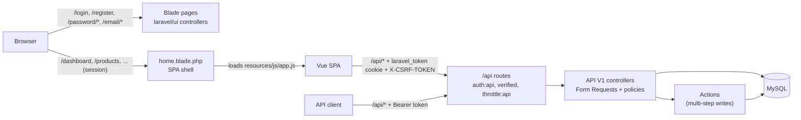

# Architecture

How the application is put together: request flow, code layout,
authorization, security layers, data model, Docker and CI. For setup see
[README.md](README.md); for security policy and the production checklist see
[SECURITY.md](SECURITY.md); for contribution rules see
[CONTRIBUTING.md](CONTRIBUTING.md).

## Overview

One Laravel 13 application (PHP 8.5) serves three things:

1. **Server-rendered pages** for guests: the welcome page, login,
   registration, password reset and email verification (laravel/ui
   controllers and Blade views), plus the OAuth consent screen.
2. **A Vue 3 single-page application** (the dashboard), delivered as a Blade
   shell and built with Vite.
3. **A JSON API** under `/api`, protected by the Laravel Passport `api` guard.
   The dashboard uses it, and so can other clients with a token. It is
   described in [docs/api/openapi.yaml](docs/api/openapi.yaml).

## Request flow

### Signing in (web session)

- `routes/web.php` registers the laravel/ui routes with
  `Auth::routes(['verify' => true])`: `/login`, `/logout`, `/register`,
  `/password/*` and `/email/*`. The controllers are in
  `app/Http/Controllers/Auth/`.
- The `web` guard (`config/auth.php`) is session based. Sessions are stored
  with the driver set in `SESSION_DRIVER` (`database` in `.env.example`) and
  are encrypted when `SESSION_ENCRYPT=true` (the `.env.example` value).
- Self-registration (`RegisterController`) always creates a `user` account.
  New accounts must verify their email address: `User` implements
  `MustVerifyEmail`, and the SPA route uses the `verified` middleware, so an
  unverified account is redirected to `/email/verify`.

### The dashboard (SPA)

- Every path that is not matched earlier and does not start with `api` or
  `oauth` falls through to the catch-all route at the end of `routes/web.php`.
  It renders `resources/views/home.blade.php` behind the `auth` and `verified`
  middleware.
- The shell passes the signed-in user (`id`, `name`, `email`, `type`) to Vue
  in the `data-user` attribute of `#spa-app`. There are no inline scripts.
  `resources/js/lib/user.js` reads the attribute.
- Vite builds three entries (`vite.config.js`):
  - `resources/js/app.js` creates the Vue app and Vue Router with the routes
    in `resources/js/routes.js`;
  - `resources/js/auth.js` has the styles and Bootstrap behaviour for the
    server-rendered guest pages;
  - `resources/js/api-docs.js` is the Swagger UI viewer for `/docs` (see
    [API documentation](#api-documentation)).
- The logo is `public/images/logo.svg`, shown in the sidebar and on the
  sign-in pages, with `public/favicon.svg`, `public/favicon.ico` and
  `public/apple-touch-icon.png` as icons. Their source is
  `resources/images/brand/logo.svg`; see
  [resources/images/README.md](resources/images/README.md).

### Product catalogue

- The products page (`resources/js/components/product/ProductsPage.vue`)
  shows each product's photo, SKU, category, tags, stock, status and price.
  Its search, filters (category, tag, status and stock level) and sort order
  are kept in the URL query string, so a reload or a shared link shows the
  same list. It sends them to `GET /api/product`.
- `ProductIndexRequest` validates those query parameters. Unknown values are
  rejected with `422`, so only allowed sort columns and bound values reach
  the database query. `ProductController::index()` applies them with the
  query scopes on `Product` (`search`, `taggedWith`, `stockLevel`,
  `lowStock`, `outOfStock`). `search` escapes `%` and `_`, so they match
  literally.
- A product is "low stock" with 1 to `Product::LOW_STOCK_THRESHOLD` (5) units
  and "out of stock" with 0. `GET /api/product/stats` returns the counts the
  dashboard shows (by status, low stock and out of stock).
  `resources/js/lib/products.js` holds the same statuses, stock levels,
  sort options and threshold for the dashboard and the products page.
- `ProductRequest` stores SKUs trimmed and in upper case. A SKU is required
  when creating a product and must be unique.
- The optional demo data (`php artisan db:seed`) is an everyday retail
  catalogue of 6 categories, 8 tags and 14 products. The product images are
  in `public/images/products/`, and their SVG sources in
  `resources/images/products/`.

### The SPA calling the API

- Passport's `CreateFreshApiToken` middleware is appended to the `web` group
  (`bootstrap/app.php`). On every `GET` page load by a signed-in user it sets
  the encrypted, HttpOnly `laravel_token` cookie.
- `resources/js/bootstrap.js` configures axios to send `Accept:
  application/json`, `X-Requested-With` and the `X-CSRF-TOKEN` header (from
  the `csrf-token` meta tag). No token is ever stored in Web Storage.
- The `api` guard (driver `passport`) accepts either a bearer token or the
  `laravel_token` cookie. The cookie is only accepted together with a
  matching CSRF token; otherwise the request is unauthenticated.
- The axios response interceptor sends the browser to `/login` on `401` or
  `419`, and to `/email/verify` on a `403` whose message is
  `Your email address is not verified.`.

### API clients

- Other clients send `Authorization: Bearer <token>`. Users create personal
  access tokens on the dashboard's Developer page, which uses Passport's JSON
  API (`/oauth/personal-access-tokens`, `/oauth/clients`, `/oauth/tokens`,
  `/oauth/scopes`). `AppServiceProvider` turns those routes on with
  `Passport::$registersJsonApiRoutes = true`.
- The OAuth authorization-code consent screen is
  `resources/views/vendor/passport/authorize.blade.php`. The device
  authorization grant is turned off.
- Token lifetimes (`AppServiceProvider`): access tokens 15 days, refresh
  tokens 30 days, personal access tokens 6 months.

### API routes

- `routes/api.php` (prefix `/api`, middleware group `api`). Every route except
  `GET /api/version` uses `auth:api` and `verified`.
  `EmailVerificationTest` checks this for every API route.
- Successful responses are `App\Http\Responses\ApiResponse` objects, which
  return `{"success": true, "data": ..., "message": "..."}` with status 200.
  Records are serialized by the API Resources in `app/Http/Resources/`
  (`UserResource`, `CategoryResource`, `TagResource`, `ProductResource`,
  `ProductTagResource`), which list every field explicitly. List endpoints
  put a Laravel paginator (10 per page) in `data`, with its items mapped to
  resources (`->through(...)`), so the paginator fields stay the same. `GET /api/product` also accepts
  `per_page` (up to 50) and the search, filter and sort parameters described
  in [Product catalogue](#product-catalogue).
- `bootstrap/app.php` renders exceptions as JSON for `api/*` and for requests
  that expect JSON. When `APP_DEBUG` is false, 404 bodies are
  `{"message": "Not Found."}` so they do not name model classes.

### API documentation

- `GET /docs` shows [docs/api/openapi.yaml](docs/api/openapi.yaml) in Swagger
  UI, and `GET /docs/openapi.yaml` returns the document. Both routes are in
  `routes/web.php`, handled by `App\Http\Controllers\ApiDocsController` and
  guarded by `App\Http\Middleware\AuthorizeApiDocs`.
- `config/api-docs.php` (`API_DOCS_ENABLED`) turns them on. The default is
  on only when `APP_ENV=local`, where anyone can open them. In other
  environments they are only served to signed-in administrators with a
  verified email address (the `viewApiDocs` gate). When turned off, both
  return 404.
- The viewer is a separate Vite entry, `resources/js/api-docs.js`, so the
  dashboard bundle does not include it. It runs under the normal CSP.
- `OpenApiDocumentTest` fails if an `/api` route is missing from the
  document, or the document lists an operation without a route.

## Directory map

| Path | Contents |
| --- | --- |
| `app/Actions/` | Single-purpose classes for writes that take more than one step: `Products/CreateProduct`, `Products/UpdateProduct`, `Products/SyncProductTags`, `Products/StoreProductImage`, `Users/CreateUser`, `Profile/UpdateProfile`, `Profile/ChangePassword`. |
| `app/Console/Commands/CreateAdmin.php` | `php artisan app:create-admin`, the only way to create the first administrator (interactive). |
| `app/Http/Controllers/Api/V1/` | API controllers. |
| `app/Http/Resources/` | API Resources: the fields of each record in API responses. |
| `app/Http/Responses/ApiResponse.php` | The `{success, data, message}` envelope of successful API responses. |
| `app/Http/Controllers/Auth/` | laravel/ui login, registration, password reset and verification controllers. |
| `app/Http/Controllers/ApiDocsController.php` | `/docs` viewer page and `/docs/openapi.yaml`. |
| `app/Http/Middleware/` | `SecurityHeaders` (CSP and other headers) and `AuthorizeApiDocs`. |
| `app/Http/Requests/` | Form Requests: `Categories/CategoryRequest`, `Tags/TagRequest`, `Products/ProductRequest`, `Products/ProductIndexRequest`, `Products/ProductImageRequest`, `Users/UserRequest`, `Users/ProfileUpdateRequest`, `Users/ChangePasswordRequest`. |
| `app/Enums/` | `UserType` (`admin`, `user`), `ProductStatus` (`active`, `draft`, `archived`) and `StockLevel` (the `in`, `low` and `out` values of the product list's `stock` filter). |
| `app/Models/` | `User`, `Product`, `Category`, `Tag`. |
| `app/Policies/` | One policy per model, linked to it with `#[UsePolicy]` on the model. |
| `app/Providers/AppServiceProvider.php` | Passport settings, rate limiters, trusted proxies, the `viewApiDocs` gate, the password rule (`Password::defaults()`). |
| `app/Rules/PasswordByteLength.php` | Rejects passwords longer than 72 bytes (the bcrypt limit). |
| `app/Support/ImageReencoder.php` | Decodes and re-encodes uploaded images with GD. |
| `bootstrap/app.php` | Routing, middleware and exception handling setup. |
| `config/` | Laravel configuration, including `api-docs.php`, `cors.php` and `passport.php`. |
| `database/migrations/`, `database/factories/`, `database/seeders/` | Schema, test factories and optional demo data (the product catalogue; no user accounts). |
| `docs/api/openapi.yaml` | OpenAPI 3.1 description of `/api`. |
| `docker/` | `Dockerfile` (targets `dev`, `node-dev`, `prod`), Apache and PHP configuration, entrypoints. |
| `public/images/`, `public/favicon.*`, `public/apple-touch-icon.png` | Logo, icons and demo product images. |
| `resources/images/` | SVG sources of the logo and the demo product images, and `render.mjs`, which renders the product images. |
| `resources/js/` | Vite entries (`app.js`, `auth.js`, `api-docs.js`), the root component `App.vue`, `routes.js`, `Gate.js`, `components/` and `lib/` helpers. |
| `resources/views/` | Blade views: SPA shell (`home.blade.php`), guest layout (`layouts/master.blade.php`), auth pages, `api-docs.blade.php`, Passport consent page. |
| `routes/web.php`, `routes/api.php` | Web and API routes. |
| `tests/Feature/`, `tests/Unit/` | PHPUnit tests. They use an in-memory SQLite database. |
| `tests/e2e/` | Playwright end-to-end tests, and the scripts and Compose file for the throwaway stack they run against (`setup/`, `compose.yaml`). |
| `.zap/rules.tsv` | Rules for the OWASP ZAP baseline scan. |
| `.github/` | CI, end-to-end tests, ZAP scan, CodeQL and Dependabot configuration. |

## Authorization model

- **Account types.** `users.type` is `admin` or `user`, cast to the
  `App\Enums\UserType` enum (`UserType::Admin`, `UserType::User`;
  `User::isAdmin()`). `type` is not mass assignable. It is
  only set through `App\Actions\Users\CreateUser`, by
  `RegisterController` (always `user`), `UserController` (administrators)
  and `app:create-admin`, and on update by `UserController`.
- **Policies** (`app/Policies/`):

  | Policy | View, create, update | Delete |
  | --- | --- | --- |
  | `ProductPolicy`, `CategoryPolicy`, `TagPolicy` | Any account | Administrators |
  | `UserPolicy` | Administrators | Administrators, but not their own account |

  Create and update are authorized in the Form Requests
  (`CategoryRequest`, `TagRequest`, `ProductRequest`, `ProductImageRequest`,
  `UserRequest`), delete in the controllers with `$this->authorize()`.
  Category, product and tag routes use route model binding, so an unknown id
  returns `404`. `bootstrap/app.php` runs the `verified` middleware before
  route model binding, so an unverified account gets `403` either way.
  `UserController` does not use route model binding: it checks `viewAny`
  before it looks up an account, and `UserRequest::authorize()` does the same
  for create and update, so a non-administrator gets `403` and cannot probe
  which ids exist. Category, product and tag `index`/`show` actions do not
  call the policy; every verified account may read them.
- **Other rules.** `UserRequest` stops administrators from changing their
  own `type`. `ProfileUpdateRequest` only accepts `name` and `email`.
- **Gates.** `viewApiDocs` (administrators) protects `/docs` outside the
  local environment.
- **In the browser.** `resources/js/Gate.js` and `meta.admin` in
  `resources/js/routes.js` only hide menu entries and pages. The API enforces
  every rule on its own.

## Security layers

Details and operational advice are in [SECURITY.md](SECURITY.md).

- **Security headers.** `App\Http\Middleware\SecurityHeaders` is appended to
  every response. It sends a Content-Security-Policy with a per-request
  nonce (`Vite::useCspNonce()`, which the `@vite` directive adds to script
  tags), `X-Content-Type-Options`, `X-Frame-Options`, `Referrer-Policy`,
  `Permissions-Policy` and `Cross-Origin-Opener-Policy`, and HSTS on HTTPS
  requests. The policy is `script-src 'self' 'nonce-…'` without
  `'unsafe-eval'` or `'unsafe-inline'`; `style-src` allows
  `'unsafe-inline'`. Only in the local environment, and only while the Vite
  dev server is running (`public/hot` exists), is the dev server origin
  added. Templates therefore contain no inline scripts or inline event
  handlers.
- **Rate limits** (named limiters in `AppServiceProvider`): `api` 60 per
  minute per account or IP; `login` 10 per minute per IP, plus the laravel/ui
  lockout after 5 failures per email and IP; `register` 5 per minute per IP;
  `password-reset` 5 per minute per IP and 10 per hour per email. Email
  verification links use `throttle:6,1`.
- **CSRF.** Web forms use Laravel's CSRF protection. API requests that
  authenticate with the `laravel_token` cookie must send the CSRF token.
- **Passwords and tokens.** Passwords are 12 to 72 characters and at most 72
  bytes (`Password::defaults()`, set in `AppServiceProvider`). Changing a password (profile, administrator, or reset) rotates the
  remember token and revokes every OAuth access and refresh token of the
  account (`User::booted()`). Because of `authenticateSessions()` in
  `bootstrap/app.php`, browser sessions that signed in with the old password
  are signed out when they next load a page. Deleting an account also
  revokes its tokens. The
  forgot-password form answers the same way whether or not the email
  exists.
- **Uploads.** `POST /api/product/upload` accepts JPEG, PNG and WebP images
  up to 5 MB and 4096x4096 pixels. `ImageReencoder` decodes the image and
  stores a re-encoded copy, which drops metadata and hidden data. Files get
  random names on the `public` disk (`storage/app/public/uploads`). In the
  Docker images Apache never executes files there and denies script, HTML,
  SVG and JavaScript files.
- **CORS** (`config/cors.php`): only `APP_URL` and the origins in
  `CORS_ALLOWED_ORIGINS`, for `api/*`, without credentials.
- **Error output.** JSON errors are generic when `APP_DEBUG` is false.
  Password fields are never flashed to the session.

## Data model

From `database/migrations/` and `app/Models/`:

| Table | Columns (main) | Notes |
| --- | --- | --- |
| `users` | `id`, `name`, `type`, `email` (unique), `email_verified_at`, `password`, `remember_token`, timestamps | Model `User`. |
| `categories` | `id`, `name`, `description`, timestamps | Model `Category`. |
| `tags` | `id`, `name`, timestamps | Model `Tag`. |
| `products` | `id`, `name`, `sku` (unique, nullable), `description`, `price` (`decimal(10,2)`), `stock` (unsigned integer, default 0), `status` (`active`, `draft` or `archived`, default `active`, indexed; cast to `App\Enums\ProductStatus`), `category_id`, `photo`, timestamps, `deleted_at` | Model `Product` (soft deletes). `price` is cast to a string with two decimals. `photo_url` is an accessor that `ProductResource` adds to responses. `sku` is empty only for products created before SKUs existed. |
| `product_tag` | `product_id`, `tag_id` | Pivot table for products and tags. |
| `password_resets` | `email`, `token`, `created_at` | Password reset tokens (`config/auth.php`). |
| `oauth_clients`, `oauth_access_tokens`, `oauth_refresh_tokens`, `oauth_auth_codes`, `oauth_device_codes` | | Laravel Passport. Client ids are UUIDs unless `PASSPORT_CLIENT_UUIDS=false`. |
| `sessions`, `cache`, `cache_locks`, `failed_jobs` | | Laravel framework tables. |

Relations defined in the models:

- `Product` belongs to `Category` (`category_id`).
- `Product` belongs to many `Tag` through `product_tag`. In product
  responses `ProductTagResource` returns the tag name as `text`, the format
  the tag input in the dashboard uses.
- `User` has Passport tokens (`HasApiTokens`).

The migrations do not create foreign key constraints. Deleting a category
does not change its products; their `category` is then `null`.

## Docker topology

`docker-compose.yml` (development):

| Service | Image or target | Port on the host | Purpose |
| --- | --- | --- | --- |
| `app` | `docker/Dockerfile`, target `dev` | `127.0.0.1:${APP_PORT:-8000}` to 8080 | Apache and mod_php as `www-data`. The project is bind mounted. Runs `composer install` on first start. Health check on `/up`. |
| `db` | `mysql:9.7.4` | Not published | MySQL. Data in the `db_data` volume. `docker-compose.db-port.yml` publishes it on `127.0.0.1` when needed. |
| `mailpit` | `axllent/mailpit` | `127.0.0.1:${MAILPIT_PORT:-8025}` | Catches every email the app sends. |
| `node` (profile `dev`) | `docker/Dockerfile`, target `node-dev` | `127.0.0.1:${VITE_PORT:-5173}` | Vite dev server. `node_modules` lives in a volume. |

All services set `no-new-privileges`, and `app` and `node` also drop all
Linux capabilities.

The `prod` target is a self-contained image: production Composer
dependencies, the built Vite assets, application code owned by root and
read-only, and only `storage/` and `bootstrap/cache/` writable. Apache listens
on 8080, serves only `public/`, and the entrypoint runs
`php artisan optimize`. Migrations are never run automatically.

## Continuous integration

- `.github/workflows/ci.yml`, on pushes to `main` and on pull requests:
  - **php**: `composer validate --strict`, `composer install`,
    `composer audit`, Pint (`composer lint`), Larastan level 9
    (`composer analyse`) and `php artisan test`.
  - **frontend**: `npm ci`, ESLint, Prettier check, `npm audit
    --audit-level=moderate` and `npm run build`.
  - **docker**: builds the `prod` target and checks that `/up` responds.
- `.github/workflows/e2e.yml`, on pushes to `main`, on pull requests and on
  demand: builds the `prod` image, starts the end-to-end stack with
  `tests/e2e/setup/start-stack.sh` (the `prod` image, MySQL and Mailpit) and
  runs the Playwright tests in Chromium with `tests/e2e/setup/run-tests.sh`.
  The HTML report and traces are uploaded as the `playwright-report`
  artifact.
- `.github/workflows/zap.yml`, weekly, on demand and on pull requests to
  `main` that change code or configuration that shapes HTTP responses:
  starts the same stack and runs an OWASP ZAP baseline scan of the
  signed-out pages. Only the rules set to `FAIL` in `.zap/rules.tsv` fail the
  job; the report is uploaded as the `zap-baseline-report` artifact.
- `.github/workflows/codeql.yml`: CodeQL for JavaScript/TypeScript and GitHub
  Actions on pull requests, pushes to `main` and weekly.
- `.github/dependabot.yml`: weekly update pull requests for Composer, npm,
  Docker images, Docker Compose and GitHub Actions.
- `azure-pipelines.yml`: a legacy Azure Pipelines check that runs the PHP test
  suite in the `dev` image. GitHub Actions is the primary CI.
