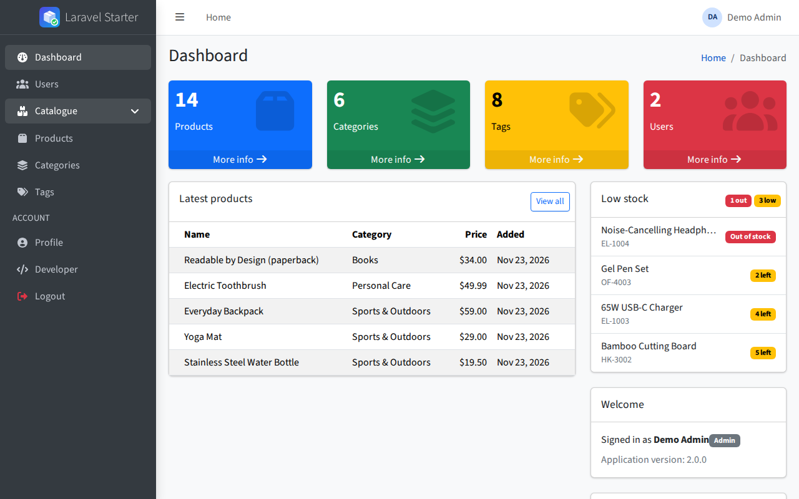
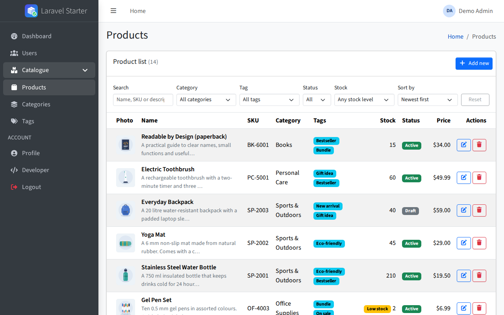
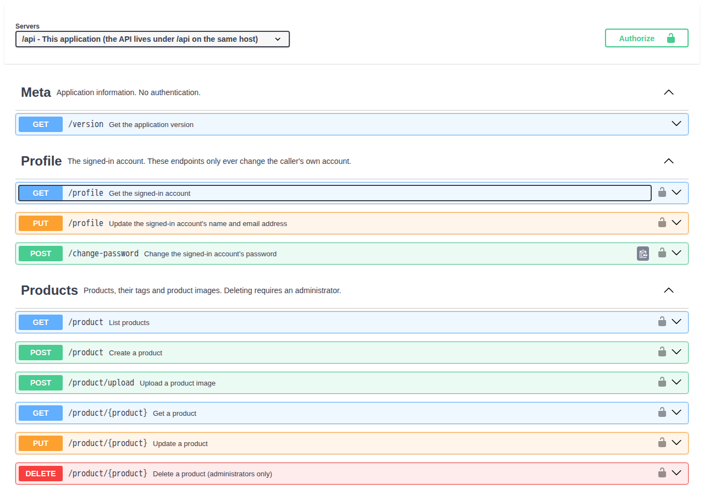

# Laravel + Vue CRUD Starter

[](https://github.com/AnowarCST/laravel-vue-crud-starter/actions/workflows/ci.yml)
[](https://github.com/AnowarCST/laravel-vue-crud-starter/actions/workflows/codeql.yml)

A Laravel 13 + Vue 3 + AdminLTE 4 single-page application (SPA) starter with
CRUD screens, session login with email verification, and an OAuth2 JSON API.
It runs in Docker, is hardened by default, and comes with PHP, JavaScript and
end-to-end tests.





## Features

- Modal-based create and edit, paginated lists, delete with confirmation
- Login, register, email verification, forgot and reset password
- Profile: update name and email, change password
- Product catalogue with SKU, stock level and status (active, draft,
  archived), search, filters and sorting that are kept in the URL, and image
  upload
- Dashboard with product counts and a low-stock list
- User management (admin only)
- Categories and tags (admin only in the menu)
- Role-based access control (admin and user) on the API and in the UI
- Developer page for OAuth clients and personal access tokens
- API documentation in Swagger UI at `/docs`
- Hardened by default, see [SECURITY.md](SECURITY.md)

## Tech stack

- PHP 8.5, Laravel 13, Laravel Passport 13 (OAuth2 / personal access tokens)
- Vue 3 + Vue Router, built with Vite (SweetAlert2, axios)
- AdminLTE 4 + Bootstrap 5 + Font Awesome
- MySQL 9.7 LTS
- Node 26 LTS (build tooling only)
- PHPUnit, Playwright and an OWASP ZAP baseline scan
- Pint and Larastan (PHP), ESLint and Prettier (JavaScript and Vue)
- Docker (Apache + mod_php) for development and production, Mailpit for
  local email

## Quick start with Docker

Requirements: Docker Engine 24+ with Docker Compose v2.

```bash
git clone https://github.com/AnowarCST/laravel-vue-crud-starter.git
cd laravel-vue-crud-starter
cp .env.example .env
```

Edit `.env` and set **strong, different** values for `DB_PASSWORD` and
`DB_ROOT_PASSWORD` (for example with `openssl rand -base64 32`). On Linux,
also set `HOST_UID`/`HOST_GID` to the output of `id -u`/`id -g`.

```bash
docker compose up -d --build            # app, MySQL and Mailpit
# The first start installs the PHP dependencies. Wait until the app answers:
docker compose exec app sh -c 'until curl -so /dev/null http://127.0.0.1:8080/up; do sleep 3; done'
docker compose exec app php artisan key:generate
docker compose exec app php artisan migrate
docker compose exec app php artisan passport:keys
docker compose exec app php artisan passport:client --personal --no-interaction
docker compose exec app php artisan storage:link
docker compose --profile dev run --rm node sh -c "npm ci && npm run build"
```

Open <http://localhost:8000>. Emails (verification, password reset) are
caught by Mailpit at <http://localhost:8025>. For hot reload, run the Vite
dev server instead of the build: `docker compose --profile dev up -d node`.

Optional demo data (6 categories, 8 tags and 14 products, no user
accounts): `docker compose exec app php artisan db:seed`.

Ports, the database client port, the Vite dev server, installing without
Docker and the production image are described in
[docs/installation.md](docs/installation.md).

## First admin account

There is no default account and no seeded password. Create the first
administrator interactively; the command asks for the email address, name
and password:

```bash
docker compose exec app php artisan app:create-admin
```

Accounts created this way are verified. Accounts that sign up through the
registration form are regular users and must verify their email address.

## Everyday commands

| Task | Command |
| --- | --- |
| Run the PHP tests | `docker compose exec app php artisan test` |
| PHP code style (Pint) | `docker compose exec app composer lint` (fix: `composer format`) |
| PHP static analysis (Larastan, level 10) | `docker compose exec app composer analyse` |
| JavaScript and Vue lint (ESLint) | `docker compose --profile dev run --rm node npm run lint` (fix: `npm run lint:fix`) |
| JavaScript and Vue formatting (Prettier) | `docker compose --profile dev run --rm node npm run format:check` (fix: `npm run format`) |
| Production build (Vite) | `docker compose --profile dev run --rm node npm run build` |
| Dependency audits | `docker compose exec app composer audit` and `docker compose --profile dev run --rm node npm audit` |

Tests use an in-memory SQLite database and never touch your MySQL data. With
Node 26 on your machine, you can run the `npm` commands directly. More
options, the OpenAPI lint and the ZAP scan are in
[docs/testing.md](docs/testing.md).

### End-to-end tests

The Playwright tests in `tests/e2e/` run in Chromium against a throwaway
stack (the production image, MySQL and Mailpit on ports 8080 and 8125),
never against your development database:

```bash
npm ci
tests/e2e/setup/start-stack.sh    # build the prod image, start the stack, create test accounts
tests/e2e/setup/run-tests.sh      # run the tests in the Playwright Docker image
tests/e2e/setup/stop-stack.sh     # remove the stack and its generated secrets
```

Requirements, options, rate limits and reports are described in
[docs/testing.md](docs/testing.md#end-to-end-tests).

## API documentation

[docs/api/openapi.yaml](docs/api/openapi.yaml) describes every `/api`
endpoint in OpenAPI 3.1. The app shows it in Swagger UI at `/docs` (for
example <http://localhost:8000/docs>) and serves the file at
`/docs/openapi.yaml`. The viewer is bundled by Vite and loads nothing from a
CDN.



- With `APP_ENV=local`, both pages are on and anyone who can reach the app
  can open them.
- In any other environment they are off and return 404. Set
  `API_DOCS_ENABLED=true` to turn them on; then only signed-in
  administrators with a verified email address can open them.
- `API_DOCS_ENABLED=false` turns them off everywhere, including local.

"Try it out" uses your signed-in session. To use a personal access token
instead, create one on the Developer page and enter it under **Authorize**.
`php artisan test` fails if an `/api` route is missing from the document.

## CI/CD

GitHub Actions runs the PHP and frontend checks
(`.github/workflows/ci.yml`) and CodeQL on every pull request and every push
to `main`. The slower workflows are opt-in: the production Docker build, the
end-to-end tests and the OWASP ZAP scan run when a maintainer adds the
`run-docker-build`, `run-e2e` or `run-zap` label to a pull request, when
started by hand from the **Actions** tab, or on every pull request when the
repository variable `RUN_DOCKER_BUILD`, `RUN_E2E` or `RUN_ZAP` is `true`.

`deploy/` has disabled, fully commented deployment templates: GitHub Actions
(GitHub Container Registry, optional SSH deploy), then AWS (CodeBuild, ECR,
ECS), then Azure (Azure Pipelines, Azure Container Registry). Nothing in
them runs until you enable it.

[docs/ci-cd.md](docs/ci-cd.md) explains when each workflow runs, how to turn
the opt-in ones on, which checks to require, and how to enable a template.

## Deployment

Build the production image:

```bash
docker build -f docker/Dockerfile --target prod -t laravel-vue-crud-starter:prod .
```

It contains the production Composer dependencies and the built assets, but no
Composer, Node or git. Apache runs as `www-data` on port 8080. Provide
configuration as environment variables, mount `storage/` on a persistent
volume, and run migrations yourself after a backup. Details are in
[docs/installation.md](docs/installation.md#production-image); go through the
[production checklist](SECURITY.md#production-checklist) before you go live.

## Upgrading

Upgrading an installation of the Laravel 8 / Vue 2 version involves breaking
changes. Follow the steps, including backup and rollback, in
[docs/upgrading.md](docs/upgrading.md).

## Security

Please report vulnerabilities privately, not in a public issue. See
[SECURITY.md](SECURITY.md) for how to report one and for the security
measures and production checklist.

## Contributing

Contributions are welcome. Please read:

- [CONTRIBUTING.md](CONTRIBUTING.md): development setup, commit conventions,
  the checks a pull request must pass, and how to add a CRUD module;
- [ARCHITECTURE.md](ARCHITECTURE.md): how the application is put together;
- [CODE_OF_CONDUCT.md](CODE_OF_CONDUCT.md): the Contributor Covenant 2.1,
  which everyone taking part agrees to follow;
- [docs/ai-assistants.md](docs/ai-assistants.md): instructions for AI coding
  assistants ([AGENTS.md](AGENTS.md), `CLAUDE.md`, `.cursor/rules/`).

## Images

The logo (`public/images/logo.svg` and the favicons) and the product
illustrations (`public/images/products`) were made for this project and are
released under the MIT license with the rest of the code. Their sources are in
`resources/images`; see [resources/images/README.md](resources/images/README.md).

## License

The code is released under the [MIT license](LICENSE). The built assets and
the production image also contain third-party software under its own
licences (for example MIT, Apache-2.0 and SIL OFL 1.1); see
[THIRD_PARTY_NOTICES.md](THIRD_PARTY_NOTICES.md). `npm run build` writes
their licence texts to `public/build/licenses.txt`.
